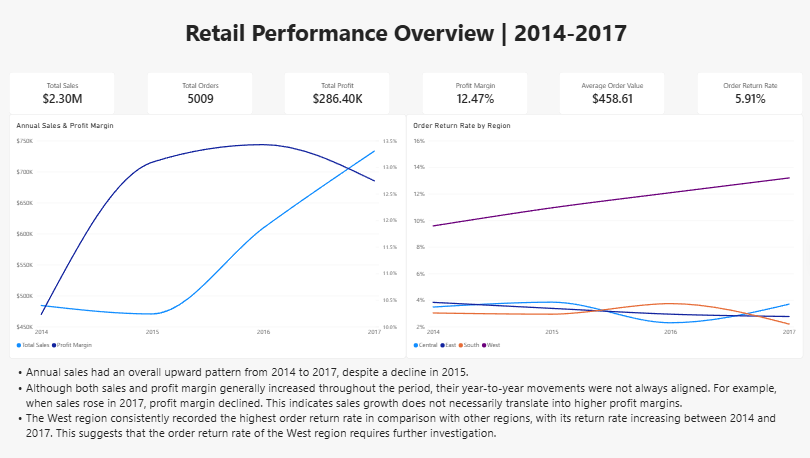
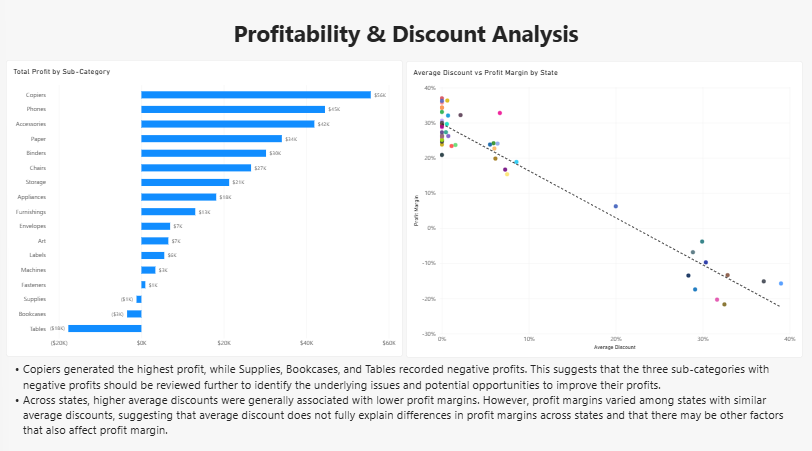

# Retail Sales & Profitability Analysis

## Project Overview

This project analyzes retail sales data from 2014 to 2017 to evaluate 
overall business performance. The analysis focuses on sales growth, 
profitability, discounting, and returns in order to identify business 
areas that may warrant management attention. 

## Business Questions 

1. How did sales, profit, and profit margin change by year?
2. Which sub-categories generated the most/least profit?
3. How do average discount and profit margin vary by state?
4. How did order return rate vary by region and year?
5. How did customer segments compare in sales and profitability?
6. Within Furniture, how did profit margin vary by discount level and sub-category?

## Dataset

The dataset contains 9.994 records, with each row representing an individual order line,
covering transactions from 2014 to 2017. The data includes information on orders, customers, 
products, sales, profit, discounts, returns, and geography. A separate calendar table was used 
to support time-based analysis. 

## Data Preparation & Modeling 

Data preparation included cleaning and transforming the source data in Power Query, 
validating data types and dates, and creating supporting dimension tables. 
A `Product_Key` was created because one `Product ID` could map to multiple product names, 
and vice versa. 
The cleaned data was organized into a fact table with product, customer, and calendar 
dimensions to support analysis in Power BI and SQL.

## Tools

Excel and Power Query were used for data cleaning, transformation, and initial validation.
Power BI was used for data modeling, visualization, and dashboard analysis. 
MariaDB and DBeaver were used to reproduce and validate key findings with SQL. 

## Analysis & Key Findings 

### Sales Growth and Profitability 

Sales increased overall from 2014 to 2017, despite dropping in 2015. 
Profit margin generally improved over the period but declined slightly in 2017, 
showing that changes in sales and profit margin did not always align. 

### Product Profitability 

Copiers generated the highest total profit, while Supplies, Bookcases, and Tables 
generated negative profit. This indicates that profitability varied substantially 
across sub-categories and that the weakest-performing areas may warrant further review. 

### Discounting and Profit Margin 

States with higher average discounts generally had negative profit margins, 
although states with similar average discounts sometimes showed vaeried margins. 
This suggests that discounting was associated with profit margin, but it cannot 
fully explain the observed differences, and other factors may also contribute. 

### Regional Returns 

West had the highest return rates throughout 2014-2017. 
Its consistently higher rates compared with other regions may warrant further review. 

### Customer Segment Performance 

Consumer generated the highest sales and profit but had the lowest profit margin, 
while Home Office had the lowest sales and profit but the highest profit margin. 
This indicates that higher sales and profit do not necessarily result in a higher profit margin. 

### Furniture Discount Analysis

Profit margins generally decreased as discount levels increased across Furniture sub-categories.
This suggests that higher discounting is associated with lower profit margins within Furniture, 
although the relationship varied across sub-categories. 

## Recommendations / Areas for Further Investigation

- **Regional returns:** West's return rates were consistently higher than those of other regions. 
Further analysis should examine state-level returns within the West to determine where 
the elevated return rate is concentrated.

- **Product profitability:** Some sub-categories had negative total profit. 
Further analysis should examine product-level sales and profitability within those 
sub-categories to determine whether weak profitability is concentrated in specific products 
or broadly distributed. 

- **Discounting:** Across both the state-level analysis and the Furniture sub-category analysis,
higher discounting was associated with lower profit margins. Further analysis could examine 
product/category mix across states and product-level performance within Furniture to determine 
whether the relationship is broadly distributed or concentrated in particular products or states. 

- **Customer segments:** Segment-level results showed that higher sales and profit do not 
necessarily correspond to a higher profit margin. Further analysis at the customer and product levels
could help determine whether differences in segment profit margins are driven by customer-level performance,
product mix, or broaded segment-wide patterns. 

## Data Quality & Limitations 

- **Date validation:** Source date fields were validated as MM/DD/YYYY to ensure dates were interpreted 
correctly and consistently throughout the analysis.

- **Product identification:** Because `Product ID` and `Product Name` were not individually unique, 
`Product_Key` was created to uniquely identify product records and support the product dimension. 

- **Return-rate calculation:** Because the return flag was recorded at the order level but repeated across
order-line rows, returned orders and total orders were calculated using distinct `Order ID` values to avoid 
double-counting multi-line order. 

- **Shipping data:** `Ship_Days` showed an unusual banded distribution, with values clustered around 1-7 days 
and then recurring at substantially higher ranges such as 28-37, 59-67, and 89+ days. Because the reason 
for this pattern could not be verified from the available data, `Ship_Days` was excluded from 
shipping-performance conclusions. 

- **Cost limitation:** The dataset does not include product- or unit-level cost details, so the analysis 
cannot fully explain the cost structure behind why some products or sub-categories perform poorly. 

- **Discount interpretation:** The analysis identified an association between discounting and profit margin, 
but this relationship should not be interpreted as causal. 

## Project Files

- **Excel workbook:** `excel/retail_data_preparation.xlsx` 
  Data preparation, Power Query transformations, and data-quality validation. 

- **Power BI report:** `powerbi/retail_sales_profitability_analysis.pbix`
  Data model, dashboard, and interactive analysis. 

- **SQL analysis script:** `sql/retail_analysis.sql`
  Import validation, relationship-integrity checks, and business analysis queries.

- **Cleaned CSV tables:** `data/dim_calendar.csv`, `data/dim_customer.csv`,
  `data/dim_product.csv`, and `data/fact_order_lines.csv`
  Fact and dimension tables used to recreate the MariaDB dataset. 

- **Database schema:** `sql/schema.sql`
  Table definitions for recreating the SQL environment. 

